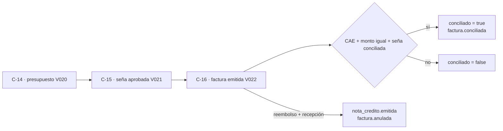

# Design

## Context

Ver `proposal.md` §Why para la motivación. El estado que condiciona el diseño:

- Stack resuelto en C-02: Java 17, Spring Boot 3.5.16, Maven, JPA, PostgreSQL y DDD bajo `com.turnosodontologia`. `spring-boot-starter-web` ya aporta `RestTemplate`; no hay SDK ni cliente HTTP nuevo que instalar.
- C-14 entregó `presupuestos`/`items_presupuesto` en `V020`, con `total NUMERIC(12,2)`, `moneda=ARS`, `estado` y ítems a precio snapshot. Su contrato estable (D11) es `presupuesto.id`, `total`, `moneda`, `estado`, `turno_id` opcional e ítems; C-14 no almacena comprobante, impuesto ni cobro.
- C-15 entregó `senias` en `V021` con `estado` (`pendiente|aprobado|rechazado|cancelado|reembolsado`), `monto`, `moneda=ARS`, `conciliado`, `presupuesto_id`/`turno_id` sin FK física y dedupe en `public_idempotencia` (V004, operación `pago.webhook`). Conciliación reducida a flag + auditoría; caja/asiento/arqueo quedaron diferidos por MP-3. C-15 ya está archivado y no se reabre.
- `AuditoriaCatalogo` es lista blanca cerrada; la Decisión 1 de C-05 exige acta PO escrita y un test por escenario para cada tipo nuevo. El acta es `docs/decisiones/C-16-decisiones.md` (AR-12), aprobada el 2026-11-23. `AuditoriaMetadataValidator` prohíbe `dni`, `documento_numero`, `direccion`, `firma`, `token`, etc.
- Las superficies financieras `/presupuestos` y `/senias` son `@Profile({"dev","test"})`, sin RBAC nuevo; `TestJpaConfig` escanea `application`, `infrastructure.audit`, `publicbooking` y `depositpayments`. No existe `@SpringBootApplication` en `src/main` (limitación registrada, competencia de C-17/C-18).
- V021 es la última migración aplicada; la tabla de reservas de `CHANGES.md` asigna V022 a este change. El número `011` del scope histórico quedó supersedido.
- No existe ninguna variable ARCA en `.env.example`, `application*.yml`, `pom.xml` ni código; `SecretsInventoryTest` exige solo nombres de variables sin valores.

## Goals / Non-Goals

**Goals:**

- Emitir como máximo una factura por seña aprobada, por el importe cobrado, con evidencia de intentos, estado y CAE de prueba.
- Encadenar el `conciliado` de C-15 con un flag verificable en el comprobante, sin duplicar reglas de referencia.
- Mantener la línea base de 287 tests verdes y un CI que arranque sin secretos ARCA reales.
- Dejar el catálogo de auditoría y la metadata acotados a lo aprobado por el PO.

**Non-Goals:**

- Caja, asiento, arqueo, cierre impositivo ni libro IVA (AR-3).
- Impresión/PDF y lectura del comprobante por el paciente (C-14 D13/D14).
- Modificar C-14, C-15, `/auth/**`, el adaptador de actor ni el RBAC de agenda.
- SDK, proveedor externo de facturación, gestor de secretos ni `@SpringBootApplication`.
- Facturación del saldo del presupuesto, reconsulta a ARCA, notificaciones reales ni disparo automático de nota de crédito.

## Decisions

Las decisiones de producto `AR-1`..`AR-14` están aprobadas en `docs/decisiones/C-16-decisiones.md`; aquí se registra su traducción técnica y la alternativa descartada.

1. **Disparador y modelo (AR-1, AR-2)** — servicio de aplicación que consume `senia_id` y crea una fila en la tabla nueva `comprobantes`. Alternativa descartada: `ALTER TABLE presupuestos`, que ensuciaría el contrato estable de C-14 D11 y mezclaría presupuesto con imagen fiscal.
2. **Sin renglones ni impuestos (AR-4, AR-5)** — un solo `monto NUMERIC(12,2)` en `ARS`, letra `C` y punto de venta como parámetros no secretos; IVA no discriminado. Alternativa descartada: tabla de alícuotas, sin base aprobada y en tensión con C-01 A5.
3. **Datos del receptor (AR-6)** — se reutilizan los campos ya existentes de `pacientes`; no se crea tabla fiscal ni superficie de carga. Si falta un dato exigido por el proveedor, emisión `pendiente` y aviso por puerto NO-OP a recepción. Alternativa descartada: pedir CUIT en la reserva pública, con impacto en Ley 25.326 y fuera del alcance aprobado.
4. **Puerto e integración (AR-7, AR-8)** — `FacturacionPort` con dos adaptadores: REST con `RestTemplate` para producción y NO-OP/simulado para `dev`/`test`, devolviendo un CAE determinista de prueba. Alternativa descartada: SDK de ARCA o proveedor de facturación como servicio externo (dependencia nueva, presupuesto y aprobación adicionales).
5. **Idempotencia y reintentos (AR-9)** — operación `factura.emitir` en `public_idempotencia`, clave SHA-256 de `senia.id`, escrita en la misma transacción que el cambio de estado y el evento. Un reintento desde `rechazado` reutiliza la clave y actualiza `intentos`/`ultimo_error`; no hay outbox, async ni `REQUIRES_NEW`. Detalle técnico derivado: la nota de crédito usa la operación `nota_credito.emitir` con clave derivada del `comprobante.id`, para no colisionar con la emisión de la factura. Alternativa descartada: columna de clave propia en V022, que duplicaría el mecanismo ya verificado en V004.
6. **Conciliación (AR-10)** — se lee el flag `conciliado` de la seña, no se escribe. `factura.conciliada` solo si CAE, montos iguales y seña `aprobado`+`conciliado`. Alternativa descartada: marcar la seña desde ARCA, que reabriría C-15.
7. **Nota de crédito (AR-11)** — operación manual de recepción que valida `senia.estado = reembolsado` y el total; la factura pasa a `anulado`. Alternativa descartada: suscribirse al evento `pago.reembolsado` de C-15, que exigiría reabrir un change archivado.
8. **Auditoría (AR-12)** — cinco tipos nuevos en `AuditoriaCatalogo`, entidad `comprobante`, actores `recepcionista` (`SIMULADO`) y `system` (`SYSTEM`), metadata con claves permitidas y sin CAE ni datos personales, con un test por escenario. Alternativa descartada: reutilizar `pago.conciliado` para la factura, que perdería la trazabilidad por entidad.
9. **Superficie y wiring (AR-13)** — paquete `com.turnosodontologia.invoicing`, controlador `@Profile({"dev","test"})` con cuatro rutas, sin RBAC nuevo; registrar el paquete en `TestJpaConfig`. Alternativa descartada: exponer la emisión en producción sin autenticación de staff, que rompería las guardias de C-04.
10. **Configuración segura (AR-7, AR-14)** — `ARCA_BASE_URL` y `ARCA_ACCESS_TOKEN` solo como nombres en `.env.example`; el perfil `test` define `http://localhost` y un token explícitamente de prueba para que GitHub Actions arranque sin secretos. Los valores productivos quedan fuera del repositorio y de logs/metadata.

## Risks / Trade-offs

- **[Riesgo] Emisión duplicada por reenvío o reintento concurrente** → Mitigación: unicidad de `senia_id` en V022 más dedupe en `public_idempotencia` con la misma clave y transacción; test de reenvío y de reversión atómica.
- **[Riesgo] Filtrado de CAE, credenciales o datos del receptor** → Mitigación: metadata cerrada, validador existente y test que inspecciona logs, respuesta y `ultimo_error`.
- **[Riesgo] CI roto por variables ARCA ausentes** → Mitigación: defaults no productivos en el perfil `test` y `SecretsInventoryTest` con nombres sin valores.
- **[Riesgo] Conciliación declarada antes de que C-15 complete la suya** → Mitigación: condición explícita sobre `senia.conciliado` y evento solo en el caso válido.
- **[Riesgo] Nota de crédito emitida sin reembolso real** → Mitigación: validación de `senia.estado = reembolsado` y operación manual; sin disparo automático.
- **[Trade-off] CAE simulado en dev/test** → No acredita facturación real ante ARCA; queda marcado como prueba y la emisión productiva requiere credenciales fuera del repositorio.
- **[Trade-off] Sin caja ni asiento** → No hay libro IVA ni arqueo en este change, según MP-3 y AR-3; es una limitación declarada, no un olvido.

## Migration Plan

1. Crear `V022__arca_invoicing.sql` con `comprobantes`, checks, índices y unicidad de `senia_id`. No editar V001–V021; la tabla `public_idempotencia` de V004 se reutiliza sin cambios de esquema.
2. Verificar con `Migration022Test` sobre `PostgresFlywayTest` que V022 aplica limpia, V001–V021 permanecen intactas y no aparecen tablas de caja, asiento ni arqueo.
3. Implementar entidad, puerto, adaptadores, servicio, superficie y wiring en `com.turnosodontologia.invoicing`; ampliar `AuditoriaCatalogo` y registrar el paquete en `TestJpaConfig`.
4. Ejecutar tests de idempotencia, reintento, conciliación, nota de crédito, auditoría y secretos desde la línea base de 287 tests verdes; verificar `openspec validate arca-invoicing-reconciliation --strict`.
5. Rollback: no hay `down` de Flyway; ante fallo se revierte el despliegue de la aplicación y se conserva V022 aplicada sin datos de facturación real en entornos de prueba. La emisión productiva requiere aprobación humana previa por la governance CRITICO.

## Out of scope tracking

Los pendientes declarados en el acta (caja/asiento/arqueo, PDF y lectura paciente, adaptador de actor, RBAC de agenda, `@SpringBootApplication`, gestor de secretos, owner legal/dossier, métricas, saldo del presupuesto, disparo automático de nota de crédito, reconsulta y notificaciones reales) no tienen tareas en este change y se documentan como diferidos en `tasks.md`.
