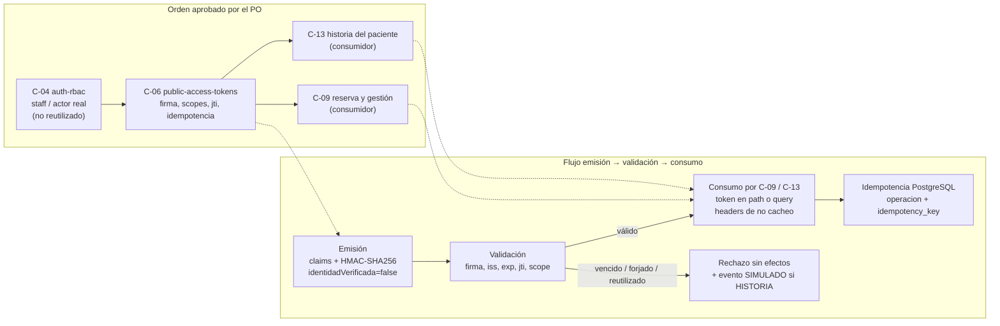

# Design

## Context

C-04 archivó `auth-rbac` con credenciales de staff acotadas a su propio paquete y un proveedor de actor real separado del simulado. C-08/C-07 dejaron la agenda y los catálogos sin autenticación en dev/test y un `AuditEventPublisher` en modo SIMULADO. Las guardias `AgendaSurfaceTest` y `CurrentActorProviderTest` prohíben, fuera del paquete `auth`, los literales `SecurityContext`, `@RequestHeader`, `Authorization`, `Bearer ` y `/auth`; C-06 no las modifica. La KB fija el acceso público por enlace/QR, sin cuenta de paciente, y deja la identidad para historia como `(TBD)` (RN-AG-06, RN-GL-02). Ver `proposal.md` para la motivación y `specs/public-access-tokens/spec.md` para el contrato observable. Stack: Java 17, Spring Boot 3.5.16, JPA, Flyway, PostgreSQL 17/Testcontainers (H2 solo unitarios), `mvn`, paquete base `com.turnosodontologia`.

## Goals / Non-Goals

**Goals:**

- Emitir, validar, rechazar y rotar tokens públicos con firma HMAC-SHA256 y secreto propio, sin credenciales de staff.
- Persistir solo metadatos (`jti`/hash e idempotencia) en V004, con unicidad por operación probada en PostgreSQL.
- Mantener el token fuera de request headers y de logs, y fijar los response headers de no referencia/no cacheo.
- Publicar un evento SIMULADO de denegación de `HISTORIA` sin identidad verificada, para consumo de C-13.
- Dejar un contrato de scopes/claims estable para C-09 y C-13.

**Non-Goals:**

- Endpoints de negocio de C-09/C-13, webhooks propios de C-10/C-15, QR/UI, generación de links, ventana de 48 hs hábiles y write-back/liberación atómica.
- Auditoría persistente, hash encadenado, retención ni API de consulta (C-05).
- Reutilizar `Usuario`/`Rol` para pacientes públicos ni reutilizar `JwtService`/`AUTH_JWT_SECRET` de C-04.
- Ajustar guardias de C-04, tocar `openspec/specs/**` durante el propose ni ejecutar apply/tests/commits en este paso.

## Decisions

- **Servicio separado del paquete `auth`.** Nuevo paquete público (por ejemplo `com.turnosodontologia.publictoken`) con: `PublicTokenService` (emitir/validar/rotar), `PublicTokenSigner` (HMAC-SHA256 con `PUBLIC_TOKEN_SECRET`), `PublicTokenMetadata` (entidad/repositorio de `jti`), `PublicIdempotencyStore` y un componente de respuesta que fija los headers. No se importa código de `auth`: su secreto y sus claims son de staff. Alternativa descartada: reutilizar `JwtService` con otro parámetro de secreto, porque acoplaría la superficie pública al contrato de sesiones y al paquete protegido por las guardias.
- **Firma y validación.** JWT compacto con cabecera `HS256`, `typ` opcional, verificación en tiempo constante y comparación estricta de `iss`. Se validan `exp`, `iat`, `scope` conocido, `jti` no usado/revocado y la vinculación: `RESERVAR` sin `turnoId` al emitir, `GESTIONAR` con `turnoId`, `HISTORIA` con `pacienteId`. Un token que afirme `identidadVerificada=true` se trata como inválido mientras C-13 no redefina ese claim mediante un change; C-06 siempre emite `false`. Vigencias objetivo: 60 min / 7 días / 24 h, configurables por scope, documentadas como metas iniciales no normativas.
- **Transporte y headers.** El token se recibe por `@PathVariable`/`@RequestParam` (path o query); el `idempotency_key` viaja en cuerpo o path. No se leen request headers: se prohíben las anotaciones y literales detectados por las guardias. Un filtro/interceptor de superficie pública fija `Referrer-Policy: no-referrer` y `Cache-Control: no-store` en éxito y rechazo, configurando los prefijos públicos por propiedad para no inventar paths de C-09/C-13. Alternativa descartada: cabecera `Authorization`, incompatible con el contrato aprobado y con las guardias.
- **No logging del token.** Sanitización de URI/query en logging de request y de mensajes de excepción; el token no se incluye en `toString`, metadata de eventos ni correlation ids. Se usa un identificador de correlación opaco. La verificación del escenario 6 captura los logs con un appender de test. Alternativa descartada: confiar en que el framework no loguea la query string.
- **`jti` y rotación.** V004 guarda `jti` con `used_at`/`revoked_at`, `scope`, vinculación, `issued_at`, `expires_at` y un hash del token cuando sea necesario, sin texto plano. La rotación es una transición atómica solo de `GESTIONAR`: marca el `jti` anterior como usado y emite uno nuevo con el mismo `turnoId`. Reutilizar un `jti` usado/revocado se rechaza; no se rota `RESERVAR` ni `HISTORIA`. Alternativa descartada: mantener el estado solo en memoria, que no sobreviviría a reinicios ni permitiría detección entre réplicas.
- **Anti-reenvio (RN-GL-02).** Tabla de idempotencia con `operacion` + `idempotency_key` (o su hash) únicos en PostgreSQL; la inserción ocurre antes del efecto de negocio y una colisión devuelve la repetición sin segundo efecto. La `operacion` es un valor opaco provisto por C-09/C-13, sin enum propio: así se evita fijar semántica no decidida (RN-GL-03). H2 puede cubrir lógica unitaria, pero la unicidad y la concurrencia se prueban contra el contenedor compartido.
- **V004 solo metadatos.** `V004__public_access_tokens.sql` crea las tablas de `jti`/idempotencia; no crea ni altera `Turno.token_publico`, columna ya definida en V006. En bases con V006 registrada se requiere `spring.flyway.out-of-order=true` (ya en `application-dev.yml`); el test correspondiente debe cubrir ese escenario. No se crea el archivo durante el propose.
- **Auditoría SIMULADA.** La denegación de `HISTORIA` por `identidadVerificada=false` publica un `AuditEvent` vía `AuditEventPublisher` con actor simulado de paciente y metadata sin token. No se persiste, no se crea `/auditoria` y `audit-event-emission` queda intacto hasta C-05.
- **Secretos.** Solo el nombre `PUBLIC_TOKEN_SECRET` se agregará a `.env.example` durante el apply, sin valor y distinto de `AUTH_JWT_SECRET`. En este propose no se edita `.env.example`.
- **Proceso vigente para el apply.** Un test por escenario del spec, sin triangulación extra (C-06 no tiene excepciones); un ciclo por grupo — escribir tests, implementar, correr una vez — sin fase `REFACTOR` separada; durante desarrollo solo `mvn test -Dtest=...` y suite completa al cerrar. Se reutiliza el único PostgreSQL compartido en `src/test/java/com/turnosodontologia/support/PostgresFixture.java`. Invariantes: cobertura de cada escenario, 147 tests previos en verde y `openspec validate public-access-tokens --strict` válido. El apply requiere aprobación explícita del PO.

## Risks / Trade-offs

- [Token en query/path expuesto a historial o referrer] → `Referrer-Policy: no-referrer`, `Cache-Control: no-store`, sin logs del token y rotación restringida a `GESTIONAR`; es el transporte exigido por el PO.
- [Secreto propio mal aislado de `AUTH_JWT_SECRET`] → inyección explícita de `PUBLIC_TOKEN_SECRET`, contrato de `iss` separado y tests que rechazan tokens firmados con el secreto de staff.
- [Base con V006 previa que ignore V004] → `out-of-order` en dev/test y escenario de test dedicado; sin base de producción afectada.
- [Colisión de idempotencia entre operaciones] → unicidad compuesta por operación y clave, con test en PostgreSQL que demuestra que la misma clave en operaciones distintas no colisiona.
- [C-13 interprete `HISTORIA` como identidad verificada] → el spec y el doc de decisiones fijan que C-06 nunca emite `true` y que el mecanismo real es responsabilidad de C-13.
- [Guardias de C-04 fallen por literales accidentales] → ningún archivo público usa `Authorization`, `Bearer `, `@RequestHeader`, `SecurityContext` ni `/auth`; los tests de esas guardias no se editan.

## Migration Plan

1. Con el apply aprobado: agregar solo el nombre `PUBLIC_TOKEN_SECRET` a `.env.example` y la configuración de vigencias por scope, sin valores secretos reales.
2. Crear `V004__public_access_tokens.sql` con tablas de metadatos e índices únicos; verificar en PostgreSQL/Testcontainers tanto una base nueva como una con V006 registrada y `out-of-order=true`.
3. Desarrollar por grupos con TDD: emisión/validación, rechazos, rotación, idempotencia, headers, logging, V004 y evento SIMULADO; un test por escenario y una corrida por grupo.
4. Cerrar con suite completa (147 tests previos + nuevos), `openspec validate public-access-tokens --strict` y verificación de que `openspec/specs/**`, `CHANGES.md` y las guardias quedaron intactos. Rollback en dev/test: recrear la base; no hay borrado físico de datos de usuario ni despliegue a producción.

## Open Questions

Diferibles sin cambiar specs, enfoque ni tareas:

- Los prefijos concretos de rutas públicas los definen C-09 y C-13; C-06 solo provee el contrato y un mecanismo configurable de headers.
- Los nombres/valores de `operacion` para idempotencia los eligen C-09 y C-13; C-06 los trata como cadenas opacas.
- El mecanismo real de verificación de identidad y su transición a `identidadVerificada=true` los define C-13 mediante un change posterior.

## UI Mockups

- Decision: no (no UI)
- Fecha: 2026-11-21
- C-06 es un contrato de seguridad/backend; no cambia páginas, pantallas, componentes, layout, estilos ni interacciones. No aplica Política de sistema visual ni mockups.
