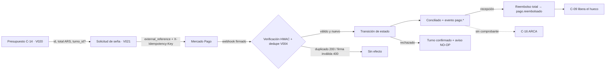

# Design

## Context

Ver `proposal.md` para la motivación. El estado que condiciona el diseño es:

- Stack resuelto en C-02: Java 17, Spring Boot 3.5.16, Maven, PostgreSQL y DDD bajo `com.turnosodontologia`. `spring-boot-starter-web` aporta `RestTemplate`; no hay SDK de Mercado Pago ni se instalará una dependencia nueva.
- C-14 entregó `presupuestos`/`items_presupuesto` en `V020`, con `id`, `total NUMERIC(12,2)`, `moneda=ARS`, `estado`, `turno_id` opcional e ítems a precio snapshot. Su superficie `/presupuestos` es `@Profile({"dev","test"})` y no exige credenciales de staff. El contrato estable de C-14 es lo único que C-15 consumirá del presupuesto.
- C-06 dejó `public_token_jti` y `public_idempotencia` en `V004`; C-09 define la operación de idempotencia por caso de uso y la ventana de 48 hs hábiles. El webhook nuevo no consume token público.
- `AuditoriaCatalogo` es una lista blanca cerrada; la Decisión 1 de C-05 exige proponer por escrito cada tipo nuevo y un test por escenario. Ese acta existe: `docs/decisiones/C-15-decisiones.md`, aprobada por el PO el 2026-11-23.
- `AuditoriaMetadataValidator` rechaza claves sensibles normalizadas; los eventos de dinero usan claves acotadas y no incluyen secretos ni datos personales.
- Tabla de reservas Flyway: Parte 3 desde V020; V020 ya la consumió C-14. Este change usa **V021** y deja V022+ para C-16. El número `010` del scope histórico está supersedido.
- No hay `@SpringBootApplication` en `src/main` (limitación ya registrada en C-09 D13): la verificación usa contexto Spring de test y Testcontainers/PostgreSQL.
- Gobernanza local **CRITICO**: el propose es análisis aprobado; el apply requiere una confirmación humana explícita adicional.

## Goals / Non-Goals

**Goals:**

- Registrar la seña y el pago de Mercado Pago con estado verificable e idempotencia transaccional.
- Autenticar el webhook por firma local y deduplicar reenvíos sin efectos duplicados.
- Conciliar el pago contra turno o presupuesto existente con evidencia en el log append-only.
- Reembolsar el total y liberar el hueco sin retención, respetando C-01 A4.

**Non-Goals:**

- Caja, asientos, arqueo ni semántica contable: la KB no define la entidad y el PO la difirió (MP-3).
- Facturación o comprobantes ARCA: C-16 (C-01 A1).
- Desglose de costos de API en el precio: enmienda C-01 A5 (MP-8).
- Envío real de WhatsApp: C-10; aquí solo puerto NO-OP (MP-9).
- Modificar C-09, la ventana de 48 hs, la cadena `/auth/**`, ni resolver la deuda de `AuthenticatedActor` (MP-12).
- Disparo automático cancelación → reembolso, reconsulta del pago a la API y gestor de secretos: pendientes explícitos del acta.

## Decisions

Resumen operativo de `docs/decisiones/C-15-decisiones.md`; los argumentos completos están en esa acta.

1. **MP-1 · Firma del webhook**. HMAC-SHA256 local sobre `ts`, `v1` y `x-request-id` con `MERCADOPAGO_WEBHOOK_SECRET`; firma inválida → `400` sin efectos. Alternativa descartada: reconsultar `GET /v1/payments/{id}` en cada webhook (red y reintentos no decididos).
2. **MP-2 · Integración REST**. `RestTemplate` detrás de un puerto, `POST /v1/preferences` con `APP_BASE_URL`, `external_reference = "senia-" + UUID` y `X-Idempotency-Key`. Webhook en `/publico/v1/webhooks/mercadopago`, sin token de C-06. Alternativa descartada: SDK o scope público nuevo (instalación/aprobación adicional).
3. **MP-3 · Conciliación**. Columna `conciliado` + evento; sin `Caja`/`Asiento`/arqueo en V021. Alternativa descartada: inventar contabilidad sin definición en la KB.
4. **MP-4 · Estados**. `String` con cinco valores y mapping cerrado; solo transiciones desde `pendiente`, eventos tardíos descartados, `fecha_aprobacion` = instante observado, `ARS` y `HALF_UP`. Alternativa descartada: enum SQL o refresco desde la API.
5. **MP-5 · Reembolso**. Reembolso total e inmediato por recepción sobre pagos aprobados; pago rechazado conserva el turno y avisa a recepción. Alternativa descartada: retención parcial u ocultar el hueco (C-01 A4, DD-03).
6. **MP-6 · Auditoría**. Cinco tipos `pago.*`, entidad `senia`, actores `SYSTEM`/`SIMULADO`, metadata acotada y `correlationId` por operación. Alternativa descartada: agregarlos durante el apply sin acta (prohibido por C-05).
7. **MP-7 · Idempotencia**. Reutilizar `public_idempotencia` con operación `pago.webhook`; clave = hash SHA-256 de `x-request-id` o de `external_reference`+`ts`; duplicado → `200`, nunca `409`; registro en la misma transacción. Alternativa descartada: tabla nueva o `409` (provocaría reintentos del proveedor).
8. **MP-8 · Precio**. Se aplica la enmienda C-01 A5: precio plano todo incluido, sin desglose de costos de API; los artefactos no reproducen la redacción supersedida.
9. **MP-9 · Notificación**. Puerto con implementación NO-OP/simulada, como C-09 D8; sin envío real ni eventos nuevos.
10. **MP-10 · Secretos**. Solo nombres ya presentes en `.env.example`; sin valores reales, gestor nuevo ni dependencias.
11. **MP-11 · Verificación**. Testcontainers/PostgreSQL para webhook duplicado, pago rechazado, conciliación, reembolso y auditoría; unit tests de firma, mapping y transiciones; línea base 241 tests verdes de C-14.
12. **MP-12 · Deuda de actor**. `AuthenticatedActor` queda fuera de alcance como en C-14 D1.

## Risks / Trade-offs

- **[Firma local sin reconsulta]** → Un pago confirmado en la API pero con webhook perdido no se registra; mitigación: dedupe transaccional, `400` explícito ante firma inválida y reconsulta diferida como pendiente (MP-1).
- **[Duplicado respondido con 200]** → Un evento legítimo con el mismo `x-request-id` reutilizado se descartaría; mitigación: clave compuesta `external_reference`+`ts` como respaldo y unicidad por operación `pago.webhook`.
- **[Sin caja/arqueo]** → La conciliación no produce asiento contable; mitigación: `conciliado` verificable y pendiente explícito en el acta, sin afirmar caja implementada.
- **[Reembolso manual]** → Requiere acción de recepción; mitigación: cumple A4 y no modifica C-09; el disparo automático queda registrado como pendiente.
- **[Estados terminales]** → Un reenvío tardío con información nueva se descarta; mitigación: mapping documentado y transiciones solo desde `pendiente`, con evento de auditoría solo para cambios reales.
- **[Sin aplicación ejecutable en `src/main`]** → No se puede probar el flujo HTTP integral; mitigación: Tests WebMvc con perfil de test y Postgres/Testcontainers, limitación ya conocida desde C-09 D13.

## Migration Plan

1. Crear **`V021__mercadopago_deposits.sql`** en el apply: tabla `senias` con FKs opcionales a `turnos` y `presupuestos`, `monto NUMERIC(12,2)`, `moneda` fija `ARS`, `estado` y `proveedor` como `VARCHAR` con checks, `external_reference` e `idempotency_key` únicos, `fecha_aprobacion` y `conciliado`, más índices de consulta. Sin tablas de caja/asiento/arqueo y sin edición de V001–V020.
2. Verificar con `Migration021Test` sobre `PostgresFlywayTest` que V021 aplica limpia, V020 permanece intacta y no aparecen tablas de caja ni columnas de impuestos o comprobantes.
3. Rollback: no se edita la migración aplicada; ante fallo en entorno desechable se recrea la base. En entornos con datos, corregir con una migración posterior numerada desde V022, nunca reescribiendo V021.
4. El propose **no crea la migración**: solo la declara en los artefactos. Su escritura requiere la aprobación humana del apply.

## Open Questions

Ninguna que cambie specs, enfoque o tareas. Los temas diferidos (caja/arqueo, disparo automático, reconsulta a la API, gestor de secretos, RBAC real) están registrados como pendientes explícitos en el acta y son no-objetivos de este change.
