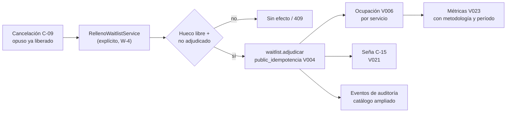

# Design

## Context

Ver `proposal.md` §Why para la motivación y `docs/decisiones/C-19-decisiones.md` (W-1..W-13) para el acta PO del 2026-11-23. El estado que condiciona el diseño:

- Stack resuelto en C-02: Java 17, Spring Boot 3.5.16, Maven, JPA, PostgreSQL y DDD bajo `com.turnosodontologia`. No hay SDK, Micrometer, Actuator, `@Scheduled` ni Outbox en el `pom.xml`.
- C-08 entregó `turnos`, `bloqueos` y `ocupaciones` en `V006`, con `btree_gist`, `tstzrange` y exclusion constraints por profesional y sillón. `Ocupacion` expone `paraTurno`, `paraBloqueo` y `desactivar`; `DisponibilidadService.huecosLibres` es solo consulta. No existe ningún `ApplicationEventListener`, evento de dominio ni gancho de «hueco liberado».
- C-15 entregó `senias` en `V021` con estados `pendiente|aprobado|rechazado|cancelado|reembolsado`, `monto`, `moneda=ARS`, `conciliado`, `turno_id`/`presupuesto_id` sin FK física, `SeniaService.solicitar/conciliar/reembolsar` y dedupe en `public_idempotencia` (V004, operación `pago.webhook`). El reembolso cancela el turno; el motor de waitlist debe verificar el estado de la ocupación sin modificar C-15.
- `AuditoriaCatalogo` es lista blanca cerrada; la Decisión 1 de C-05 exige acta PO escrita, un test por escenario y actualizar specs antes de agregar tipos. El acta es `docs/decisiones/C-19-decisiones.md` (W-10). `AuditoriaMetadataValidator` prohíbe `dni`, `telefono`, `email`, `diagnostico`, `historia_clinica`, credenciales y secretos.
- `public_idempotencia` (V004) se reutiliza sin cambios de esquema. Convención observada: eventos de auditoría en pasado (`turno.creado`), operaciones de idempotencia en infinitivo (`turno.crear`, `pago.webhook`, `factura.emitir`); C-19 usará `waitlist.adjudicar`.
- No existe outbox, WhatsApp, plantillas ni notificación real en `src/`: solo `NotificacionPublicaPort`/`NotificacionSimulada`, `NotificacionPagoPort` y `AvisoRecepcionPort` (C-09 D8, MP-9, AR-7). C-11 sigue pendiente y no se reabre.
- No existe código de métricas, ocupación, ausentismo, período ni metodología. `ConfiguracionSchedulingService.zonaHoraria()` y `VentanaHabilesService.vencimiento` son insumos de agenda, no de medición.
- Superficies financieras y de agenda usan `@Profile({"dev","test"})`. `TestJpaConfig` escanea `application`, `infrastructure.audit`, `publicbooking`, `depositpayments` e `invoicing`. No hay `@SpringBootApplication` en `src/main` (limitación registrada, competencia de C-17/C-18).

## Goals / Non-Goals

**Goals:**

- Adjudicar un hueco ya liberado a un solo candidato, de forma atómica e idempotente, sin reabrir C-09 ni usar el log de auditoría como bus.
- Reutilizar el ciclo de seña de C-15 para el depósito, conservando reembolso total, liberación inmediata y conciliación por flag.
- Calcular ocupación y ausentismo con fórmula, fuente, sillón y período explícitos, sin publicar cifras sin metodología.
- Mantener la línea base de 320 tests verdes y un CI determinista sin secretos, zona horaria local ni reloj real.

**Non-Goals:**

- Cableado automático cancelación → relleno y notificación WhatsApp real (W-4, W-3).
- Reabrir C-09, C-14, C-15 ni C-16; modificar `/auth/**`, el adaptador de actor ni el RBAC de agenda.
- Caja, asiento, arqueo, liquidación contable ni facturación del depósito (MP-3, AR-3).
- Números productivos de depósito, plazo de oferta ni metas de ocupación/ausentismo.
- Tablas de renglones de métrica, series temporales ni `metrica` por profesional: el grano es sillón y mes.
- Pantallas,dashboard o UI; solo superficie HTTP indicativa de dev/test.

## Decisions

Las decisiones de producto `W-1`..`W-13` están aprobadas en `docs/decisiones/C-19-decisiones.md`; aquí se registra su traducción técnica y la alternativa descartada.

1. **Habilitación y alcance (W-1)** — se incluye C-19 en v0.1 supersediendo el Gap C-19 de C-01. Alternativa descartada: cerrar la change sin código, que habría dejado los diferenciadores fuera del MVP.
2. **Esquema (W-2)** — una sola migración `V023__waitlist_and_metrics.sql` con `lista_espera` y `metricas_ocupacion`. Alternativa descartada: `ALTER TABLE` sobre `senias`, `turnos` u `ocupaciones`, que tocaría contratos archivados.
3. **Notificación (W-3)** — puerto `NotificacionWaitlistPort` con adaptador NO-OP/simulado. Alternativa descartada: esperar a C-11 o introducir outbox y plantillas sin decisión previa.
4. **Disparador (W-4)** — caso de uso explícito `RellenoWaitlistService.adjudicarTurnoLiberado(turnoId)`, con entrada un turno cancelado y ocupación desactivada. Alternativa descartada: `ApplicationEventListener` o consumir `auditoria_log` como bus, que reabriría C-09 y violaría MP-5.
5. **Depósito (W-5)** — `deposito_requerido` y `senia_id` opcional en la entrada; cobro mediante `SeniaService.solicitar`. Alternativa descartada: entidad de pago nueva o proveedor distinto, con costos y aprobación adicionales.
6. **Plazo (W-6)** — propiedad `waitlist.oferta.minutos` con default de prueba y `Clock` inyectado. Alternativa descartada: `Instant.now()` directo o valor productivo inventado, que harían el CI dependiente del reloj y del negocio.
7. **Adjudicación (W-7)** — una transacción con validación de disponibilidad, clave `waitlist.adjudicar` en `public_idempotencia`, creación de ocupación por servicio y evento. Alternativa descartada: constraint nueva en `V006` o inserción directa en tablas de agenda (C-09 D14).
8. **Conciliación (W-8)** — reutilizar `conciliar` y `reembolsar` de C-15, sin liquidación. Alternativa descartada: marcar la seña desde C-19, que reabriría un change archivado.
9. **Métricas (W-9)** — fórmulas fijas, bloqueos dentro de ocupación, cancelados fuera de ausentismo, período mensual en `America/Argentina/Buenos_Aires` y `metodologia` obligatoria. Alternativa descartada: inferir inasistencia de `estado=cancelado`, que mezclaría dos eventos distintos y violaría la metodología de C-01 E.
10. **Auditoría (W-10)** — seis tipos nuevos en `AuditoriaCatalogo`, entidades `lista_espera`/`turno`/`metrica`, actores de recepción (`SIMULADO`) y `system` (`SYSTEM`), metadata cerrada. Alternativa descartada: reutilizar `pago.conciliado` para la métrica, que perdería la trazabilidad por entidad.
11. **Governance (W-11)** — MEDIO con dos checkpoints. Alternativa descartada: elevar a CRITICO, innecesario porque no hay cobro nuevo, secretos ni cambios en auth/facturación.
12. **Superficie y wiring (W-12)** — paquete `com.turnosodontologia.waitlist`, controladores `@Profile({"dev","test"})`, registro en `TestJpaConfig`, propiedades con defaults de prueba. Alternativa descartada: servir la superficie en producción sin credenciales de staff, que rompería C-04.
13. **Límite con C-09 (W-13)** — se mantiene D4 (409 con hasta tres alternativas, «sin waitlist» si el hueco se toma entre consulta y confirmación); C-19 solo actúa sobre huecos ya liberados. Alternativa descartada: modificar el flujo público archivado.

## Risks / Trade-offs

- **[Riesgo] Doble adjudicación por reenvío o concurrencia** → Mitigación: clave única en `public_idempotencia`, validación con `DisponibilidadService` y exclusion constraints de V006, todo en la misma transacción; test de reenvío y de reversión.
- **[Riesgo] Reasignar un hueco cuya ocupación sigue activa** → Mitigación: la entrada exige turno cancelado y `Ocupacion` desactivada; el conflicto se rechaza sin escribir ni emitir evento.
- **[Riesgo] CI no determinista por reloj, zona horaria o secretos** → Mitigación: `Clock` inyectado, período calculado en zona fija, defaults no productivos en `application-test.yml` y sin secretos nuevos.
- **[Riesgo] Filtrado de datos personales en auditoría de métricas** → Mitigación: metadata cerrada, `AuditoriaMetadataValidator` y test que inspecciona claves persistidas.
- **[Trade-off] Ofrecimiento NO-OP** → No acredita entrega real al paciente; queda marcado como simulado y la notificación efectiva depende de C-11.
- **[Trade-off] Sin disparo automático** → El relleno requiere invocación explícita; es una limitación declarada de W-4, no un olvido.
- **[Trade-off] Sin metas numéricas** → Las cifras se publican con metodología y período, sin comparación hasta el piloto (W-9).

## Migration Plan

1. Crear `V023__waitlist_and_metrics.sql` con `lista_espera`, `metricas_ocupacion`, índices y checks. No editar V001–V022; `public_idempotencia` (V004), `senias` (V021) y `ocupaciones` (V006) se reutilizan sin cambios.
2. Verificar con `Migration023Test` sobre `PostgresFlywayTest` que V023 aplica limpia, V001–V022 permanecen intactas y no aparecen tablas de caja, asiento, arqueo ni notificación.
3. Implementar entidades, puerto, adaptador, servicios, superficie y wiring en `com.turnosodontologia.waitlist`; ampliar `AuditoriaCatalogo` y registrar el paquete en `TestJpaConfig`.
4. Ejecutar los tests de alta, ofrecimiento, expiración, adjudicación, idempotencia, depósito, conciliación, métricas y auditoría desde la línea base de 320 tests verdes; verificar `openspec validate waitlist-auto-refill-metrics --strict`.
5. Rollback: no hay `down` de Flyway; ante fallo se revierte el despliegue y se conserva V023 aplicada sin datos productivos en entornos de prueba.

## UI Mockups

- Design system revision: no aplica; el proyecto no tiene `design-system/` y su política es `visual-design=deferred`.
- Decision: no (no UI) — 2026-11-23 (W-12).
- Mockups: no aplica; la superficie es HTTP indicativa de `dev`/`test`, sin pantallas ni cambios visuales.
- Approval: no requerida (no UI).
- Preview: no aplica.
- Visual verify: no aplica.

## Out of scope tracking

Los pendientes del acta (cableado automático, WhatsApp real, montos y metas productivas, caja/asiento/arqueo, rol `dirección`, RBAC de agenda, `@SpringBootApplication`, gestor de secretos y dossier) no tienen tareas en este change y se documentan como diferidos en `tasks.md`.
