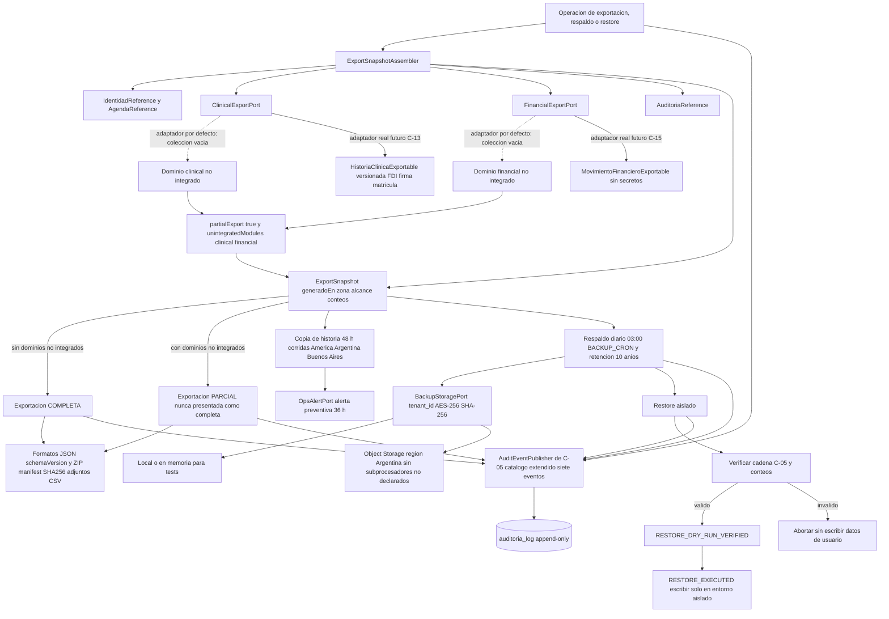

# Design

## Context

Ver `proposal.md` para motivación y gobernanza. Estado observable: C-05 ya persiste `auditoria_log` con hash SHA-256 encadenado y catálogo cerrado de cinco eventos, hoy extendido por decisión del PO; C-13 (historia clínica) y C-15 (financiero) no están en esta rama; existen los marcadores sin uso `ClinicoReference`, `FinancieroReference`, `AuditoriaReference`, `IdentidadReference`, `AgendaReference` y `NotificacionReference` en `src/main/java/com/turnosodontologia/domain/**`. V001–V009 pertenecen al Tronco Base de Lautaro (Parte 1) y dejaron reservados los rangos; por eso este change usa V030. `AuthMigrationV002Test:79` fija hoy la lista `[1..6]` y NO cambia. Existen `BACKUP_CRON` y `EXPORT_RETENTION_YEARS` como nombres en `.env.example`, sin valores; los valores aprobados viven solo en artefactos. La deuda preexistente de `openspec validate --all --strict` son 2 warnings >500 chars en `spec/agenda`; este change no la toca.

Gobernanza ALTO: el PO cerró las siete decisiones el 2026-11-24/25 y pidió artefactos con freno antes del apply. Nada de lo aquí descrito autoriza escribir código, migraciones, tests, specs principales ni `CHANGES.md`; sin apply hasta revisión del PO.

## Goals / Non-Goals

**Goals:**
- Definir contratos de exportación independientes de C-13/C-15 con adaptadores por defecto que permiten ejecutar el núcleo hoy y marcan la salida como `PARCIAL`.
- Especificar evidencia append-only con los siete eventos inmutables aprobados, extendiendo el catálogo mediante un delta `MODIFIED` dentro del change.
- Describir exportación `JSON`/`ZIP`, copia de historia en 48 h corridas con alerta a las 36 h, respaldo diario 03:00 con `BackupStoragePort` cifrado y restore verificado en entorno aislado.
- Conservar las guardias de C-04/C-05/C-06 y la deuda conocida sin rebajarlas ni reabrirlas.

**Non-Goals:**
- Sin apply, sin código de producción, sin tests de implementación, sin ejecución de suite y sin commits en este propose; sin apply hasta revisión del PO.
- Sin creación del archivo de migración; solo se nombra `V030__export_backup_restore.sql`, sin alternativa ni rastro de V007.
- Sin modificar `knowledge-base/`, `CHANGES.md`, `openspec/specs/**`, `docs/decisiones/**` ni `.env.example`.
- Sin deltas en `agenda`; el único delta es `MODIFIED` en `audit-event-emission` dentro de este change. Sin eventos inventados fuera de los siete nombres aprobados.
- Sin reabrir C-08 (sigue `[ ]` por deuda del adaptador de actor) ni pronunciarse sobre C-09..C-16 o C-18..C-22.
- Sin valores de cron, retención, destino, credenciales ni secretos en archivos de configuración del repositorio; los valores aprobados figuran solo en artefactos.
- Sin endpoints REST de auditoría, sin `/audit` ni `/auditoria`, sin permisos nuevos y sin subprocesadores no declarados.

## Decisions

### 1. Contratos desacoplados en paquete propio de C-17

Los contratos viven en `com.turnosodontologia.application.export` (o equivalente bajo `application`), no en los paquetes de dominio de otros changes. `ClinicalExportPort` entrega `HistoriaClinicaExportable`: `pacienteRef`, `fichaId`, `versión`, anamnesis mínima/texto libre, odontograma FDI con pieza temporal y estado, evoluciones con firma y matrícula, consentimientos y `generadoEn`. `FinancialExportPort` entrega `MovimientoFinancieroExportable`: `id`, `turnoRef`/`presupuestoRef`, `monto`, `moneda`, `estado`, `aprobación`, `proveedor`, `external_reference`, `conciliado`, `reembolso`, comprobante ARCA y `correlationId`; **nunca** credenciales, tokens ni firmas de webhook. `BackupStoragePort` abstrae el destino aislado por `tenant_id` con AES-256 en reposo y SHA-256; `OpsAlertPort` abstrae la alerta (log estructurado + webhook/email desacoplado). `ExportSnapshotAssembler` produce `ExportSnapshot`: identidad, agenda, clínico, financiero, auditoría, `generadoEn`, zona horaria, alcance, conteos por dominio y resultado `COMPLETA`/`PARCIAL`. Los marcadores `ClinicoReference` y `FinancieroReference` se reutilizan como identificadores opacos donde aplique; no se modifican.

Alternativa descartada: importar entidades JPA de C-13/C-15 directamente. Crearía acoplamiento a ramas ausentes y mezclaría persistencia con contrato de exportación.

### 2. Adaptadores por defecto y distinción COMPLETA/PARCIAL

Los adaptadores por defecto de `ClinicalExportPort` y `FinancialExportPort` devuelven colecciones vacías con marca explícita `partialExport: true` y `unintegratedModules` (`clinical`, `financial`), sin lanzar excepción bloqueante. El núcleo de exportación/backup/restore puede ejecutarse y testearse de punta a punta hoy. El sistema SHALL distinguir exportación `COMPLETA` de `PARCIAL`: una exportación parcial nunca se presenta como completa (RN-SE-03/04). Los únicos casos que deben fallar siguen siendo secretos/firmas de webhook, cadena de auditoría inválida, conteos divergentes y destino de restore en producción. Alternativa descartada: fail-fast por adaptador ausente, que impedía ejecutar el ciclo completo, o marcar éxito sin distinción, que produciría evidencia falsa.

### 3. Migración Flyway V030, sin alternativa

El registro de operaciones usa `V030__export_backup_restore.sql`. V001–V009 pertenecen al Tronco Base de Lautaro (Parte 1) y ya dejaron reservados los rangos; V030 garantiza cero colisiones al mergear. No hay alternativa V007 y toda referencia a esa propuesta queda eliminada. El archivo NO se crea en este propose. En el apply, `AuthMigrationV002Test:79` conserva su lista `[1..6]`: la tarea correspondiente documenta y verifica ese hecho, junto con `spring.flyway.out-of-order: true` ya existente en dev/test, sin duplicar la propiedad.

### 4. Catálogo extendido de eventos vía C-05 con delta MODIFIED

Los siete nombres inmutables aprobados por el PO son `EXPORT_REQUESTED`, `EXPORT_COMPLETED`, `EXPORT_FAILED`, `BACKUP_EXECUTED`, `BACKUP_FAILED`, `RESTORE_DRY_RUN_VERIFIED` y `RESTORE_EXECUTED`; funcionan como constantes/contrato exacto en spec y design. Cada operación publica los eventos aplicables con `correlationId`, actor, `occurredAt`, motivo/metadata y resultado. El catálogo formal de `audit-event-emission` se extiende con un delta `MODIFIED` dentro de este change (`openspec/changes/export-backup-restore/specs/audit-event-emission/spec.md`); la spec principal NO se edita y el sync ocurre en archive. No se crean endpoints REST de auditoría ni permisos nuevos; la verificación de cadena sigue siendo servicio interno sin HTTP.

### 5. Plazo de la copia de historia: 48 horas corridas

La copia conserva anamnesis mínima versionada, odontograma FDI con temporales y estado, evoluciones con firma y matrícula y consentimientos; no sobrescribe la historia (RN-CL-01/02/03). El plazo resuelto por el PO es de **48 horas corridas** desde la solicitud del titular/consultorio, interpretadas en `America/Argentina/Buenos_Aires`; al ser corridas NO se aplica cómputo de feriados (IN-05/IN-06 cerrados). La alerta preventiva a las **36 horas** se emite por `OpsAlertPort`. La emisión sin firma o matrícula se rechaza como copia completa.

### 6. Formatos, destino, cifrado y parámetros operativos

Formatos obligatorios: `JSON` estructurado y legible por máquina con campo `schemaVersion` en el contrato versionado (sin fijar un número inventado) y `ZIP` autocontenido con `manifest.json`, checksum SHA-256 y adjuntos/CSV resumido. `BackupStoragePort` aísla el destino por `tenant_id`, con cifrado AES-256 en reposo y verificación SHA-256; para tests se usa una implementación local/en memoria y el contrato queda listo para Object Storage en región Argentina, sin subprocesadores no declarados (si algún día se usa un proveedor externo, debe declararse antes). No se instala ni configura servicio externo ahora.

Parámetros aprobados: `BACKUP_CRON="0 0 3 * * *"` (diario 03:00 `America/Argentina/Buenos_Aires`) y `EXPORT_RETENTION_YEARS=10` configurable vía properties. El canal de alerta es `OpsAlertPort` (log estructurado + webhook/email desacoplado), que también emite la alerta de las 36 h. Los nombres siguen siendo solo nombres en `.env.example`: NO se escriben valores en archivos de configuración del repo ni se toca `.env.example`; en los artefactos sí figuran los valores aprobados. Sin borrado físico. Alternativa descartada: proveedor externo sin declarar o job sin destino persistente ni cifrado.

### 7. Restore aislado y verificación previa

El restore corre solo en entorno aislado; antes de escribir verifica la cadena de C-05 y la igualdad de conteos por dominio contra el snapshot. Cadena inválida, conteos divergentes o destino de producción producen abort sin escritura. Se reutiliza el servicio interno de verificación de C-05; no se expone API. Alternativa descartada: restaurar y verificar después, porque ya habría escrito sobre datos de usuario.

### 8. Secretos y superficie

Solo nombres de variables en el repositorio, nunca valores con secretos reales: `.env.example` ya contiene `BACKUP_CRON` y `EXPORT_RETENTION_YEARS` y no se modifica; los valores aprobados viven únicamente en artefactos. No se introducen `Authorization`, `Bearer`, `SecurityContext`, `@RequestHeader` ni `/auth` fuera de `auth`; se conservan `AgendaSurfaceTest`, `CurrentActorProviderTest`, `SecretsInventoryTest` y `PublicDeltaInvariantsTest` (este último lee solo `openspec/specs/**`, con agenda fija en 13 requirements / 31 escenarios). No se crean rutas `/audit`, `/auditoria`, endpoints REST de auditoría ni permisos nuevos. La exportación parcial nunca enmascara los casos que sí deben fallar: secretos/firmas de webhook, cadena inválida, conteos divergentes y destino de restore en producción.

### 9. Proceso TDD para el apply posterior (no ejecutado aquí)

Baseline informado: 194 tests en verde. Un test por escenario: 6 requirements ADDED / 29 escenarios en `export-backup-restore` y 1 requirement MODIFIED / 5 escenarios nuevos en el delta de `audit-event-emission`, 34/34 en el mapa de `tasks.md`. Ciclo ROJO→VERDE por grupo con `PostgresFixture` para cadena, concurrencia y restore; suite completa solo al cierre. Las siete decisiones ya están cerradas por el PO; no se triangula sobre valores inventados y el apply sigue frenado hasta su revisión.

## Risks / Trade-offs

- [C-13/C-15 no están en esta rama] → Adaptadores por defecto con colecciones vacías y `partialExport: true`; nunca se simula una exportación `COMPLETA`.
- [Catálogo de C-05 ampliado] → Los siete nombres están aprobados por el PO y se extienden por delta `MODIFIED` en el change; no se reutilizan eventos de agenda ni se sincroniza la spec principal antes del archive.
- [Colisión de migraciones al mergear] → V030 evita V001–V009 del Tronco Base; `AuthMigrationV002Test:79` conserva `[1..6]` y `out-of-order=true` no se duplica.
- [Falsos positivos por exportación parcial] → `partialExport`/`unintegratedModules` explícitos y distinción `COMPLETA`/`PARCIAL`; los fallos reales siguen siendo secretos, cadena, conteos y destino de producción.
- [Destino y subprocesadores] → `BackupStoragePort` con local/en memoria para tests y contrato para Object Storage en región Argentina; ningún proveedor externo sin declaración previa.
- [Restore sobre datos de usuario] → Aislamiento previo, verificación de cadena y conteos antes de escribir; abort con cualquier desajuste.
- [Deuda de `spec/agenda` con warnings >500 chars] → No se abre `specs/agenda/spec.md`; `PublicDeltaInvariantsTest` sigue fijando 13/31.
- [C-08 sigue `[ ]` por deuda del adaptador de actor] → No se toca ni se marca; C-17 no depende de esa deuda para la planeación.

## Migration Plan

1. Las siete decisiones ya están cerradas por el PO (2026-11-24/25); en este propose solo se verifican en artefactos, sin nada que resolver por convención.
2. En el apply, crear `V030__export_backup_restore.sql`, con `spring.flyway.out-of-order: true` ya existente en dev/test y sin duplicarlo; `AuthMigrationV002Test:79` conserva `[1..6]`.
3. Implementar puertos y DTO en el paquete de C-17, ensamblador con adaptadores por defecto parciales y salida `COMPLETA`/`PARCIAL`; publicar la auditoría con los siete nombres inmutables aprobados.
4. Implementar formatos `JSON`/`ZIP`, copia en 48 h corridas con alerta a las 36 h, respaldo diario 03:00 vía `BackupStoragePort` y restore aislado con verificación previa de cadena y conteos; ejecutar tests por escenario y la suite completa.
5. Recién tras revisión del PO, archive y sincronización de deltas (incluido el `MODIFIED` de `audit-event-emission`); marcar `CHANGES.md`. Nada de esto ocurre en este propose: sin apply hasta revisión del PO.

No hay rollback automático: una migración aplicada no se edita; ante fallo se corrige con migración nueva dentro del rango decidido y se repite el restore en entorno aislado antes de escribir sobre datos de usuario.

## Open Questions

No quedan preguntas abiertas que bloqueen la planeación: las siete se cerraron por decisión escrita del PO el 2026-11-24/25 y quedan registradas aquí y en `proposal.md`. No se resuelve nada por convención ni se inventan valores.

1. Migración: `V030__export_backup_restore.sql`, sin alternativa; V001–V009 reservados al Tronco Base de Lautaro (Parte 1). PO, 2026-11-24.
2. Eventos: `EXPORT_REQUESTED`, `EXPORT_COMPLETED`, `EXPORT_FAILED`, `BACKUP_EXECUTED`, `BACKUP_FAILED`, `RESTORE_DRY_RUN_VERIFIED`, `RESTORE_EXECUTED`, con delta `MODIFIED` en el change. PO, 2026-11-24.
3. Plazo: 48 horas corridas desde la solicitud, `America/Argentina/Buenos_Aires`, sin feriados, alerta a las 36 h por `OpsAlertPort`. PO, 2026-11-24.
4. Formatos: `JSON` con `schemaVersion` en el contrato y `ZIP` con `manifest.json`, SHA-256 y adjuntos/CSV resumido. PO, 2026-11-24/25.
5. Storage: `BackupStoragePort`, `tenant_id`, AES-256, SHA-256, local/en memoria para tests y listo para Object Storage en región Argentina sin subprocesadores no declarados. PO, 2026-11-25.
6. Parámetros: `BACKUP_CRON="0 0 3 * * *"`, `EXPORT_RETENTION_YEARS=10` y alerta por `OpsAlertPort`; solo nombres en `.env.example`. PO, 2026-11-25.
7. Adaptadores: por defecto devuelven colecciones vacías con `partialExport: true` y `unintegratedModules` (`clinical`, `financial`); el sistema distingue `COMPLETA` de `PARCIAL`. PO, 2026-11-25.

## UI

`Decision: no (no UI)`. Sin `design-system/`, sin mockups y sin gate visual.
